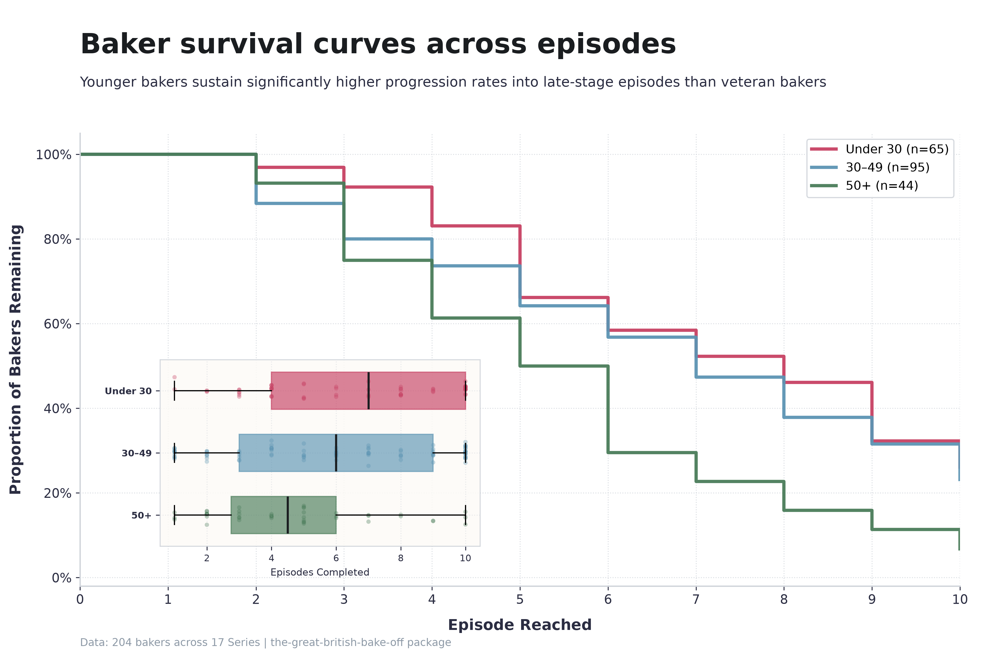
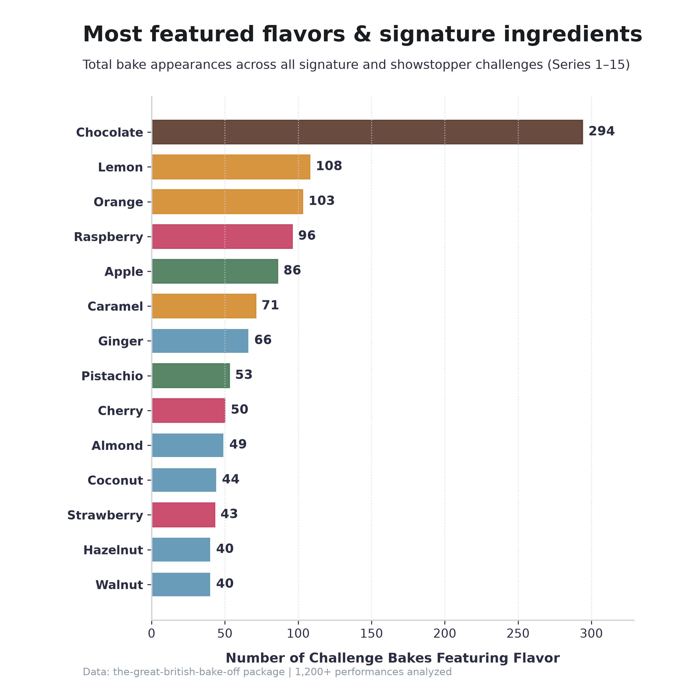
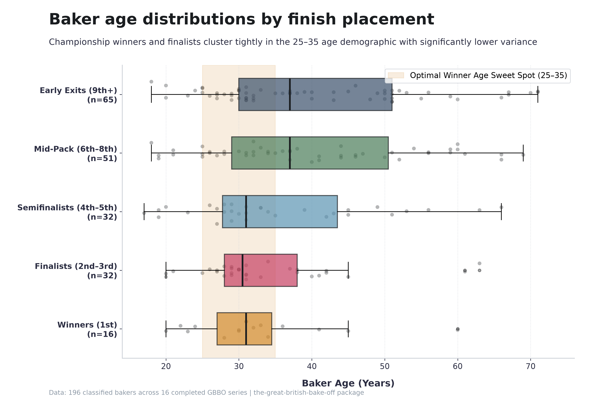
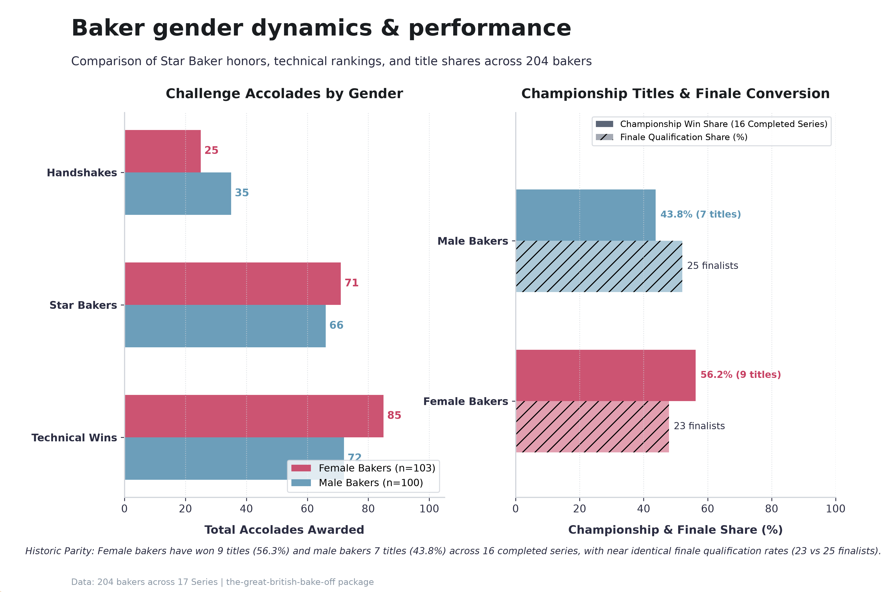
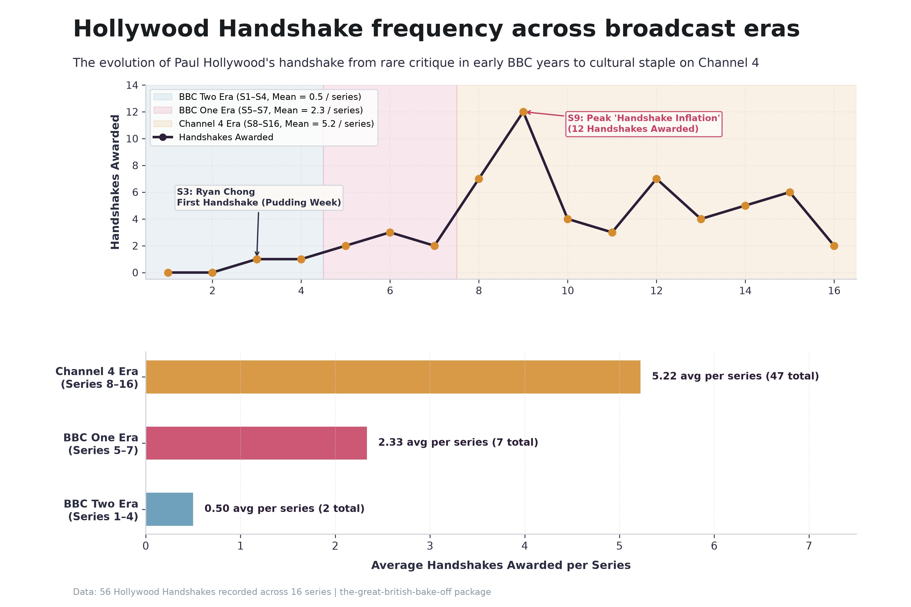
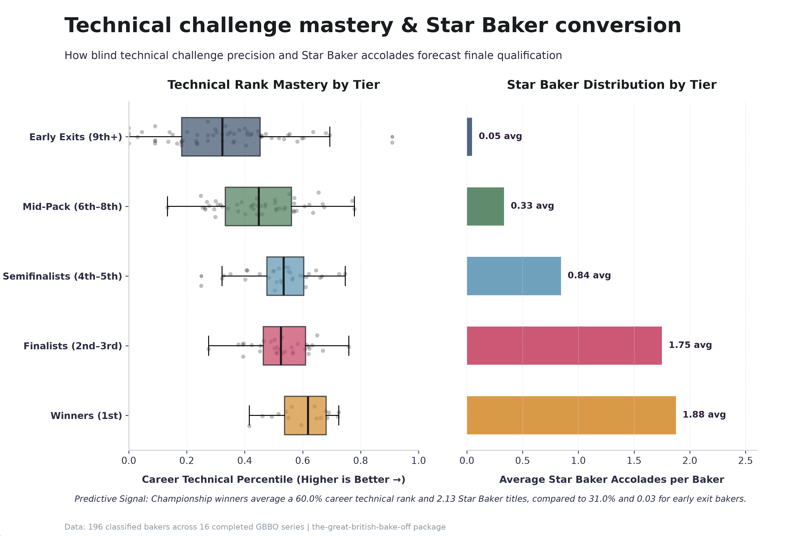

# :cake: The Great British Bake Off Dataset & AI Training Corpus :pie: 

[](https://doi.org/10.5281/zenodo.14000000)
[](https://github.com/nicholaswilde/the-great-british-bake-off/actions/workflows/ci.yml)
[](https://taskfile.dev/#/)
[](https://www.python.org/)
[](https://docs.astral.sh/uv/)
[](LICENSE)

A comprehensive tidy dataset and AI training corpus for the television series **[The Great British Bake Off](https://en.wikipedia.org/wiki/The_Great_British_Bake_Off)** (**GBBO**), broadcast as *The Great British Baking Show* in North America.

> [!WARNING]
> This project is currently in a `v0.X.X` development stage. Features and configurations are subject to change, and breaking changes may be introduced at any time.

---

## :sparkles: Features

- **Tidy Relational Tables:** Master tables for `seasons`, `bakers`, `episodes`, and `performances` validated against Pydantic schemas.
- **Rich Demographics & Metadata:** Enriched with headshot photos, age, hometown, occupation, challenge timings, and Hollywood Handshakes.
- **Multi-Format Serialization:** Exportable to JSON, CSV, Apache Parquet, Apache Arrow IPC, GeoJSON (`bakers.geojson`), unified SQLite (`gbbo.db`), and native R formats (`.rds`, `.rda`).
- **AI Training Corpora:** Pre-formatted conversational instruction tuning datasets (Chat SFT JSONL), RAG knowledge corpus, and evaluation benchmark suite.
- **Geographic Intelligence:** Geocoded WGS84 coordinates and UK administrative regions across all 204 bakers with interactive map visualizations and GeoJSON export.
- **Empirical Predictive Modeling:** Data-driven probabilistic forecasts for weekly Star Baker contenders, elimination risks, and overall series winners calibrated across 16 historical series.
- **Interactive Web Dashboard:** Streamlit application for exploratory data analysis, contestant trajectory tracking, challenge analytics, UK baker geography, and empirical outcome predictions & forecasting.


---

## :hammer_and_wrench: Tech Stack

- **Language:** Python 3.12+
- **Dependency Management:** [`uv`](https://docs.astral.sh/uv/)
- **Task Runner:** [`go-task`](https://taskfile.dev/) (`Taskfile.yml`)
- **Libraries:** `beautifulsoup4`, `lxml`, `pandas`, `pydantic`, `pyarrow`, `requests`, `rich`, `streamlit`, `typer`
- **Data Formats:** JSON, CSV, Parquet, Arrow IPC, SQLite, RDS/RDA

---

## :file_folder: Project Structure

```text
the-great-british-bake-off/
├── .agents/
│   ├── rules/          # Workspace rules (RTK, Serena, GBBO terminology, etc.)
│   └── skills/         # Workspace skills (gbbo-scrape-wiki, gbbo-dataset-builder, gbbo-predict, etc.)
├── .github/            # GitHub Actions CI/CD workflows and community health files
├── data/
│   ├── raw/            # Scraped Wikipedia series JSON files
│   ├── processed/      # Validated master datasets (bakers, episodes, performances, seasons)
│   └── predictions/    # Weekly series forecasting snapshots
├── src/
│   └── gbbo_dataset/   # Core Python library and Typer CLI (gbbo)
│       ├── models.py       # Pydantic schemas (Baker, Episode, Performance, Season)
│       ├── scraper.py      # Wikipedia extraction and cleaner
│       ├── builder.py      # Data aggregation, validation, and export
│       ├── predictor.py    # Empirical predictive modeling engine
│       ├── gap_auditor.py  # Completeness and null rate auditor
│       ├── exports.py      # Multi-format serialization & AI corpora exports
│       ├── importers/      # External dataset integrations (RayofData)
│       └── cli.py          # Unified CLI dispatcher (gbbo)
├── notebooks/          # Exploratory Jupyter starter notebooks
├── tidytuesday/        # R4DS TidyTuesday data cleaning & exploration kit
├── scripts/            # Backward-compatible script shims
├── tests/              # Pytest test suite
├── docs/               # Data dictionary, gap reports, and predictions ledger
├── dev/                # Data visualizations, brand assets, and generator scripts
├── AGENTS.md           # Agent operating instructions
├── pyproject.toml      # Managed by uv
├── Taskfile.yml        # Task automation definitions
├── _typos.toml         # Spellchecker configuration
├── CITATION.cff        # Citation File Format specification
├── .zenodo.json        # Zenodo archival DOI configuration
└── README.md
```

---

## :rocket: Quick Start

### 1. Setup Environment

```bash
task setup
```

### 2. Scrape Wikipedia Data

```bash
# Scrape Series 1
task scrape -- --series 1

# Or directly via CLI
uv run gbbo scrape --series 1

# Scrape multiple series (1 to 17)
uv run gbbo scrape --start 1 --end 17
```

### 3. Multi-Source Ingestion (Fandom Wiki & Reddit)

```bash
# Scrape Fandom wiki lore, technical recipes, and judging quotes
task scrape:fandom
# Or via CLI
uv run gbbo scrape-fandom

# Ingest Reddit episode discussions and fan sentiment
task scrape:reddit
# Or via CLI
uv run gbbo scrape-reddit

# Run all multi-source scrapers
task scrape:all
```

### 4. Build & Validate Datasets

```bash
task build
# Or via CLI
uv run gbbo build
```

Compiles raw files in `data/raw/` into validated tidy tables in `data/processed/`:
- `bakers.json` & `bakers.csv`
- `episodes.json` & `episodes.csv`
- `performances.json` & `performances.csv`

### 5. Enrich Dataset (Demographics, Handshakes, Streaming)

```bash
task enrich:ray
# Or via CLI
uv run gbbo enrich
```

### 6. NLP Flavor Profiles & Style Extraction

```bash
task nlp:flavors
# Or via CLI
uv run gbbo extract-flavors
```

Tags 1,200+ signature and showstopper dish descriptions across 13 flavor families and 6 bake styles, exporting `data/processed/bakes_nlp.json` and `flavor_analytics.json`.

### 7. Run Empirical Predictive Engine

```bash
# Run real-time predictions for in-progress series (Series 17)
task predict

# Update predictions documentation and ledger snapshots
task predict:update
# Or via CLI
uv run gbbo predict --update-docs
```

### 8. Inspect Dataset Stats & Gaps

```bash
# Row count statistics
task stats

# Completeness & gap audit
task gaps
task gaps:detail
task gaps:report
```

### 9. Export Multi-Format Datasets & AI Corpora

```bash
# Export all formats (SQLite, Arrow IPC, Parquet, R, AI corpora, GeoJSON)
task export:all

# Or individual formats:
task export:sqlite
task export:arrow
task export:r
task export:ai
task export:geojson
```

### 10. Interactive Streamlit Dashboard

Launch the interactive Streamlit dashboard to explore series summaries, baker profiles, challenge analytics, Hollywood Handshake tracking, and real-time predictions & what-if forecasting:

```bash
task dashboard
```

### 11. Run Quality Checks & Tests

```bash
# Run pytest test suite
task test

# Run complete verification suite (formatting, linting, spellcheck, tests)
task check
```

---

## :card_index_dividers: Data Schemas

### Season
- `series_number` (int): Series number (1–17+)
- `year` (int): Broadcast year
- `winner` (str): Series winner name
- `hosts` (list[str]): Series hosts
- `judges` (list[str]): Series judges
- `network` (str): Original UK broadcaster (BBC Two, BBC One, Channel 4)
- `pbs_season` (int | None): US PBS season number
- `netflix_collection` (int | None): US Netflix collection number
- `roku_season` (int | None): US Roku Channel season number
- `location` (str | None): Primary filming location

### Baker
- `baker_id` (str): Primary key, format `s{series_number:02d}_{first_name}` (e.g. `s01_edward`)
- `series_number` (int): Series number
- `name` (str): Full name
- `age` (int): Age during series
- `gender` (str | None): Baker gender (`M`, `F`, `NB`)
- `occupation` (str): Occupation
- `hometown` (str): Hometown
- `overall_placement` (int): Final placement rank (1 = Winner)
- `image_url` (str | None): Official headshot photograph URL

### Episode
- `episode_id` (str): Primary key, format `s{series:02d}e{episode:02d}` (e.g. `s01e01`)
- `series_number` (int): Series number
- `episode_number` (int): Episode number within series
- `theme` (str): Episode theme (e.g. "Cake Week")
- `air_date` (str): Broadcast air date (YYYY-MM-DD)
- `signature_time_min` (int | None): Signature challenge time limit in minutes
- `technical_time_min` (int | None): Technical challenge time limit in minutes
- `showstopper_time_min` (int | None): Showstopper challenge time limit in minutes

### Performance
- `performance_id` (str): Primary key, format `s{series}e{episode}_{baker_id}`
- `baker_id` (str): Foreign key to Baker
- `episode_id` (str): Foreign key to Episode
- `signature_dish` (str | None): Signature challenge bake
- `technical_rank` (int | None): Rank in technical challenge
- `showstopper_dish` (str | None): Showstopper challenge bake
- `result` (str): `SAFE`, `STAR_BAKER`, `ELIMINATED`, `WINNER`, `RUNNER_UP`, `WITHDREW`
- `hollywood_handshake` (bool): Whether baker received a Hollywood Handshake
- `did_well` (bool): Whether baker was called out as doing well in the episode
- `at_risk` (bool): Whether baker was in the bottom / at risk of elimination
- `absent` (bool): Whether baker was absent from episode due to illness

> [!NOTE]
> **Comprehensive Documentation**: See the [Data Dictionary & Relational Schema](docs/data_dictionary.md) for full column specifications, data types, nullability, primary/foreign keys, and Entity-Relationship diagrams across all 4 tables.
>
> **Exploratory Notebook**: Check out [`notebooks/gbbo_exploration.ipynb`](notebooks/gbbo_exploration.ipynb) for a starter Jupyter notebook covering statistical analysis, Hollywood Handshake frequencies, technical rank correlations, and SQL querying.
>
> **TidyTuesday Community Kit**: See [`tidytuesday/`](tidytuesday/) for R data cleaning scripts, exploratory visualizations, and submission templates.

---

## :bar_chart: Data Visualizations & Exploratory Analysis

Inspired by [`doehm/alone`](https://github.com/doehm/alone), the repository includes publication-quality visualizations and exploratory analyses generated from the historical tidy tables. All figures are rendered at 300 DPI and stored in [`dev/images/`](dev/images/):

### Baker Survival Curves Across Episodes

Step-down baker progression curves across Episodes 1–10 by age demographic bracket (Under 30, 30–49, 50+) alongside an inset distribution of total episodes reached:

<p align="center">
  
</p>

### Most Featured Flavors & Signature Ingredients

Total challenge appearances across 1,200+ signature and showstopper bakes spanning Series 1–15, highlighting classic cocoa, warm citrus, and berry profiles:

<p align="center">
  
</p>

### Baker Age Distributions by Finish Placement

Boxplot distributions and jittered individual baker data comparing championship winners and podium finalists against semifinalist, mid-pack, and early exit tiers:

<p align="center">
  
</p>

### Baker Gender Dynamics & Performance

Empirical distributions of challenge accolades (Technical Wins, Star Bakers, Hollywood Handshakes), championship win shares, and finale conversion rates comparing male and female bakers across 204 bakers:

<p align="center">
  
</p>

### Hollywood Handshake Frequency Across Broadcast Eras

Historical evolution of Paul Hollywood's handshake from rare critique in early BBC years (Ryan Chong in S3) through peak "Handshake Inflation" in Series 9, to modern calibration on Channel 4:

<p align="center">
  
</p>

### Technical Challenge Mastery & Finale Conversion

Career technical challenge rank percentile distributions and Star Baker honors forecasting progression and qualification for the championship finale:

<p align="center">
  
</p>

> [!TIP]
> All figures and branding assets can be generated or customized via `task images` (or `python dev/scripts/generate_images.py`).

---

## :crystal_ball: Empirical Series Predictions

<!-- GBBO_PREDICTIONS_START -->
### :trophy: Live Empirical Predictions (Series 17 - After Episode 4)

Probabilistic forecasts computed via multi-factor empirical modeling calibrated against 16 historical GBBO series. See [docs/predictions.md](docs/predictions.md) for full weekly trajectory ledgers and outcome accuracy tracking.

| Rank | Baker | Age | Avg Tech % | Handshakes | Star Bakers | Next Star Baker | Next Elim Risk | Win Prob | Finale Prob |
| :---: | :--- | :---: | :---: | :---: | :---: | :---: | :---: | :---: | :---: |
| 1 | **Tom Whittaker** | 25 | 71.1% | 0 | 2 | **26.7%** | 4.4% | **30.6%** | **87.7%** |
| 2 | **Mo Mahir** | 21 | 72.8% | 0 | 1 | **11.7%** | 8.4% | **15.7%** | **52.2%** |
| 3 | **Clara Satchell-Silva** | 24 | 55.5% | 0 | 1 | **14.4%** | 7.1% | **14.1%** | **44.9%** |
| 4 | **Moyin Odeniran** | 22 | 58.8% | 1 | 0 | **12.2%** | 8.5% | **11.0%** | **38.2%** |
| 5 | **Gabe Capes** | 32 | 84.1% | 0 | 0 | **15.6%** | 8.5% | **10.5%** | **42.0%** |
| 6 | **Elizabeth 'Connie' Lewis** | 63 | 63.6% | 0 | 0 | **8.7%** | 13.9% | **6.8%** | **29.0%** |
| 7 | **Dr. Yannis Ali** | 28 | 28.6% | 0 | 0 | **5.9%** | 23.8% | **6.3%** | **20.8%** |
| 8 | **Gary Harding** | 67 | 30.2% | 0 | 0 | **4.9%** | 25.4% | **5.1%** | **18.3%** |

> [!NOTE]
> Predictions update automatically after each broadcast episode via `task predict:update` or `uv run gbbo predict --update-docs`. See [docs/predictions.md](docs/predictions.md) for all historical episode snapshots.
<!-- GBBO_PREDICTIONS_END -->

---

## :clap: Acknowledgments & Credits

Special credit and gratitude to:
- **[RayofData](https://github.com/RayofData)** for the [The-Great-British-Bake-Off-Dashboard](https://github.com/RayofData/The-Great-British-Bake-Off-Dashboard) repository and data curation (based on the Tableau Public sample dataset). This project utilizes its curated metadata to enrich baker demographics (gender, headshot image URLs), confirm Hollywood Handshake occurrences, challenge duration times, and streaming distribution mappings across Seasons 1–14.
- **Wikipedia contributors** for comprehensive season broadcast summaries, challenge tables, and BARB viewing figures.

---

## :handshake: Contributing

Contributions, bug reports, and suggestions are welcome! Please open an issue or pull request.

---

## :bookmark: Citation

If you use this dataset, companion R package, or AI training corpus in your research or coursework, please cite it as:

```bibtex
@misc{wilde_gbbo_2026,
  author       = {Nicholas Wilde},
  title        = {The Great British Bake Off Dataset & AI Training Corpus},
  year         = {2026},
  version      = {0.1.0},
  doi          = {10.5281/zenodo.14000000},
  publisher    = {Zenodo},
  url          = {https://doi.org/10.5281/zenodo.14000000}
}
```

Or see [`CITATION.cff`](CITATION.cff), [`.zenodo.json`](.zenodo.json), and [`docs/zenodo.md`](docs/zenodo.md).

---

## :balance_scale: License

​[Apache License 2.0](LICENSE)

## :writing_hand: Author

​This project was started in 2026 by [Nicholas Wilde][2].

[2]: <https://github.com/nicholaswilde/>
