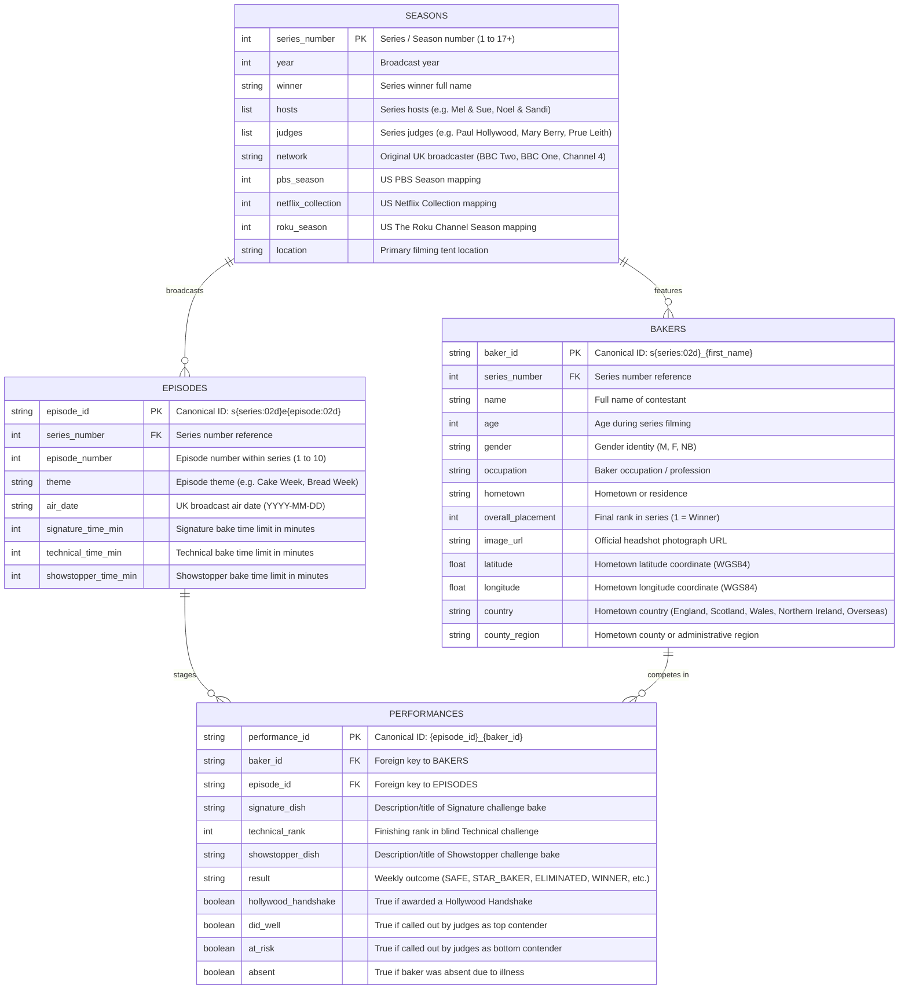

# The Great British Bake Off: Data Dictionary & Relational Schema

This document provides column-level definitions, data types, relational keys, constraints, and query guidelines for the 4 core relational tables comprising **The Great British Bake Off (GBBO)** dataset.

The dataset adheres to tidy data principles, providing consistent primary and foreign keys across all storage formats (JSON, CSV, Apache Parquet, Apache Arrow IPC, SQLite, and native R).

---

## Relational Entity-Relationship Diagram



---

## Core Tables Reference

### 1. `seasons`

Summary metadata for each broadcast series/season of the competition.

- **Primary Key:** `series_number`
- **File Paths:**
  - `data/processed/seasons.json`
  - `data/processed/seasons.csv`
  - `data/processed/seasons.parquet`
  - `data/processed/arrow/seasons.arrow`
  - `data/processed/r/seasons.rds`
  - SQLite table: `seasons` in `data/processed/gbbo.db`

| Column | Type | Nullable | Description | Example |
| :--- | :--- | :---: | :--- | :--- |
| `series_number` | `INTEGER` | No | Unique series sequence number (1–17+) | `1` |
| `year` | `INTEGER` | Yes | Year of original television broadcast | `2010` |
| `winner` | `TEXT` | Yes | Full name of the series champion | `"Edward 'Edd' Kimber"` |
| `hosts` | `TEXT` / `JSON` | No | Comma-delimited list or JSON array of series hosts | `["Sue Perkins", "Mel Giedroyc"]` |
| `judges` | `TEXT` / `JSON` | No | Comma-delimited list or JSON array of series judges | `["Paul Hollywood", "Mary Berry"]` |
| `network` | `TEXT` | Yes | Original broadcast network in the United Kingdom | `"BBC Two"` |
| `pbs_season` | `INTEGER` | Yes | Corresponding US PBS Season number | `1` |
| `netflix_collection` | `INTEGER` | Yes | Corresponding US Netflix Collection number | `1` |
| `roku_season` | `INTEGER` | Yes | Corresponding US The Roku Channel season number | `1` |
| `location` | `TEXT` | Yes | Filming estate and tent location | `"Harptree Court, Somerset"` |

---

### 2. `bakers`

Contestant demographic profiles, biographical details, and final season finish results.

- **Primary Key:** `baker_id`
- **Foreign Keys:** `series_number` references `seasons(series_number)`
- **File Paths:**
  - `data/processed/bakers.json`
  - `data/processed/bakers.csv`
  - `data/processed/bakers.parquet`
  - `data/processed/bakers.geojson`
  - `data/processed/arrow/bakers.arrow`
  - `data/processed/r/bakers.rds`
  - SQLite table: `bakers` in `data/processed/gbbo.db`

| Column | Type | Nullable | Description | Example |
| :--- | :--- | :---: | :--- | :--- |
| `baker_id` | `TEXT` | No | Canonical ID formatted as `s{series:02d}_{first_name}` | `"s01_edward"` |
| `series_number` | `INTEGER` | No | Series number in which the contestant competed | `1` |
| `name` | `TEXT` | No | Full official name of contestant | `"Edward 'Edd' Kimber"` |
| `age` | `INTEGER` | Yes | Baker age during filming | `24` |
| `gender` | `TEXT` | Yes | Gender identity (`M`, `F`, `NB`) | `"M"` |
| `occupation` | `TEXT` | Yes | Profession or occupation | `"Debt collector"` |
| `hometown` | `TEXT` | Yes | Town, city, or county of residence | `"Bradford"` |
| `overall_placement` | `INTEGER` | Yes | Final series placement rank (`1` = Winner, `2`–`3` = Runners-up) | `1` |
| `image_url` | `TEXT` | Yes | Official headshot photograph URL | `"https://..."` |
| `latitude` | `FLOAT` | Yes | WGS84 geographic latitude coordinate | `53.7960` |
| `longitude` | `FLOAT` | Yes | WGS84 geographic longitude coordinate | `-1.7594` |
| `country` | `TEXT` | Yes | Hometown country (England, Scotland, Wales, Northern Ireland, Overseas) | `"England"` |
| `county_region` | `TEXT` | Yes | Hometown administrative county or region | `"West Yorkshire"` |


---

### 3. `episodes`

Episode-level broadcast metadata, weekly challenge themes, air dates, and time constraints.

- **Primary Key:** `episode_id`
- **Foreign Keys:** `series_number` references `seasons(series_number)`
- **File Paths:**
  - `data/processed/episodes.json`
  - `data/processed/episodes.csv`
  - `data/processed/episodes.parquet`
  - `data/processed/arrow/episodes.arrow`
  - `data/processed/r/episodes.rds`
  - SQLite table: `episodes` in `data/processed/gbbo.db`

| Column | Type | Nullable | Description | Example |
| :--- | :--- | :---: | :--- | :--- |
| `episode_id` | `TEXT` | No | Canonical ID formatted as `s{series:02d}e{episode:02d}` | `"s01e01"` |
| `series_number` | `INTEGER` | No | Series number reference | `1` |
| `episode_number` | `INTEGER` | No | Episode sequence index within series (1–10) | `1` |
| `theme` | `TEXT` | Yes | Weekly baking theme | `"Cake Week"` |
| `air_date` | `TEXT` | Yes | Original broadcast air date (`YYYY-MM-DD`) | `"2010-08-17"` |
| `signature_time_min` | `INTEGER` | Yes | Time limit for Signature challenge in minutes | `120` |
| `technical_time_min` | `INTEGER` | Yes | Time limit for Technical challenge in minutes | `90` |
| `showstopper_time_min` | `INTEGER` | Yes | Time limit for Showstopper challenge in minutes | `300` |

---

### 4. `performances`

Granular challenge-by-challenge performance records for every baker in every episode.

- **Primary Key:** `performance_id`
- **Foreign Keys:**
  - `baker_id` references `bakers(baker_id)`
  - `episode_id` references `episodes(episode_id)`
- **File Paths:**
  - `data/processed/performances.json`
  - `data/processed/performances.csv`
  - `data/processed/performances.parquet`
  - `data/processed/arrow/performances.arrow`
  - `data/processed/r/performances.rds`
  - SQLite table: `performances` in `data/processed/gbbo.db`

| Column | Type | Nullable | Description | Example |
| :--- | :--- | :---: | :--- | :--- |
| `performance_id` | `TEXT` | No | Canonical ID: `{episode_id}_{baker_id}` | `"s01e01_s01_annetha"` |
| `baker_id` | `TEXT` | No | Foreign key reference to baker | `"s01_annetha"` |
| `episode_id` | `TEXT` | No | Foreign key reference to episode | `"s01e01"` |
| `signature_dish` | `TEXT` | Yes | Title/description of Signature challenge bake | `"Light Jamaican Black Cake"` |
| `technical_rank` | `INTEGER` | Yes | Blind ranking in Technical challenge (1 = best) | `2` |
| `showstopper_dish` | `TEXT` | Yes | Title/description of Showstopper challenge bake | `"Chocolate Cake with Cigarellos"` |
| `result` | `TEXT` | No | Episode outcome for baker (`SAFE`, `STAR_BAKER`, etc.) | `"SAFE"` |
| `hollywood_handshake` | `BOOLEAN` | No | Whether baker received a Hollywood Handshake | `FALSE` |
| `did_well` | `BOOLEAN` | No | Whether baker was called out as doing well | `TRUE` |
| `at_risk` | `BOOLEAN` | No | Whether baker was called out as in the bottom / at risk | `FALSE` |
| `absent` | `BOOLEAN` | No | Whether baker was absent from episode due to illness | `FALSE` |

---

## Result Enum Semantics

The `result` column in `performances` represents discrete judging outcomes:

| Outcome | Description | Typical Frequency |
| :--- | :--- | :--- |
| **`SAFE`** | The baker successfully progressed to the subsequent episode. | Majority of non-featured bakers each week. |
| **`STAR_BAKER`** | Awarded to the week's best all-around baker (introduced in Series 2). | Exactly 1 per episode (rarely 2 or tied). |
| **`ELIMINATED`** | The baker was eliminated from the competition by the judges. | Typically 1 per episode (occasionally 2 or 0). |
| **`WINNER`** | Awarded to the ultimate champion in the series finale. | Exactly 1 per series. |
| **`RUNNER_UP`** | Awarded to the remaining finalist(s) in the series finale. | Typically 2 per series. |
| **`WITHDREW`** | The baker withdrew from the competition due to personal reasons or illness. | Exceptional occurrences (e.g. Diana S05, Nikki S17). |

---

## Multi-Format Serialization Matrix

All tables are compiled and synchronized simultaneously across standard formats:

| Format | File Extension | Storage Path | Primary Tool / Ecosystem |
| :--- | :--- | :--- | :--- |
| **CSV** | `.csv` | `data/processed/{table}.csv` | Universal spreadsheets, Excel, R, Python |
| **JSON** | `.json` | `data/processed/{table}.json` | Web APIs, REST endpoints, document stores |
| **Apache Parquet** | `.parquet` | `data/processed/{table}.parquet` | DuckDB, Polars, PySpark, high-throughput analytics |
| **Apache Arrow IPC** | `.arrow` | `data/processed/arrow/{table}.arrow` | Zero-copy cross-language memory sharing |
| **SQLite DB** | `.db` | `data/processed/gbbo.db` | Embedded SQL engines, mobile applications |
| **R RDS & RDA** | `.rds`, `.rda` | `data/processed/r/{table}.rds` | R statistical workflows, tidyverse, CRAN |

---

## Query Examples

### SQL (SQLite)

```sql
-- Top 5 bakers with the most Star Baker titles
SELECT 
    b.name,
    b.series_number,
    b.overall_placement,
    COUNT(*) AS star_baker_count
FROM performances p
JOIN bakers b ON p.baker_id = b.baker_id
WHERE p.result = 'STAR_BAKER'
GROUP BY b.baker_id
ORDER BY star_baker_count DESC
LIMIT 5;
```

### Python (Pandas)

```python
import pandas as pd

# Load master tables
bakers = pd.read_parquet("data/processed/bakers.parquet")
perfs = pd.read_parquet("data/processed/performances.parquet")

# Average technical rank for series champions
winners_perfs = perfs.merge(
    bakers[bakers["overall_placement"] == 1][["baker_id", "name"]],
    on="baker_id"
)
avg_tech = winners_perfs.groupby("name")["technical_rank"].mean().sort_values()
print(avg_tech.head())
```

### R (Tidyverse)

```r
library(tidyverse)

# Load master table
performances <- readr::read_csv("data/processed/performances.csv")

# Hollywood Handshake counts per series
handshakes_by_series <- performances |>
  filter(hollywood_handshake == TRUE) |>
  mutate(series = as.integer(str_extract(episode_id, "(?<=s)\\d+"))) |>
  count(series, name = "handshakes_count") |>
  arrange(series)
print(handshakes_by_series)
```

---

## Multi-Source Auxiliary Tables

Beyond Wikipedia, multi-source ingestion pipelines extract community lore, technical recipes, and discussion threads:

### Fandom Wiki Tables (`data/processed/fandom_lore.json`, `fandom_recipes.json`)
* **`fandom_recipes`**: Technical and signature challenges, judging criteria, difficulty ratings, and official recipe links (`recipe_id`, `series_number`, `episode_number`, `challenge_type`, `dish_name`, `baker_name`, `recipe_url`, `judging_notes`, `difficulty`).
* **`fandom_lore`**: Iconic quotes ("soggy bottom"), Star Baker runner-up evaluations, and memorable tent moments (`lore_id`, `series_number`, `episode_number`, `theme`, `famous_quotes`, `star_baker_runner_up`, `notable_moments`, `source_url`).

### Reddit Discussion Tables (`data/processed/reddit_discussions.json`)
* **`reddit_discussions`**: Episode discussion threads from `r/GreatBritishBakeOff` and `r/bakeoff` (`thread_id`, `subreddit`, `series_number`, `episode_number`, `title`, `author`, `score`, `upvote_ratio`, `num_comments`, `permalink`, `top_comments`, `sentiment_label`).
